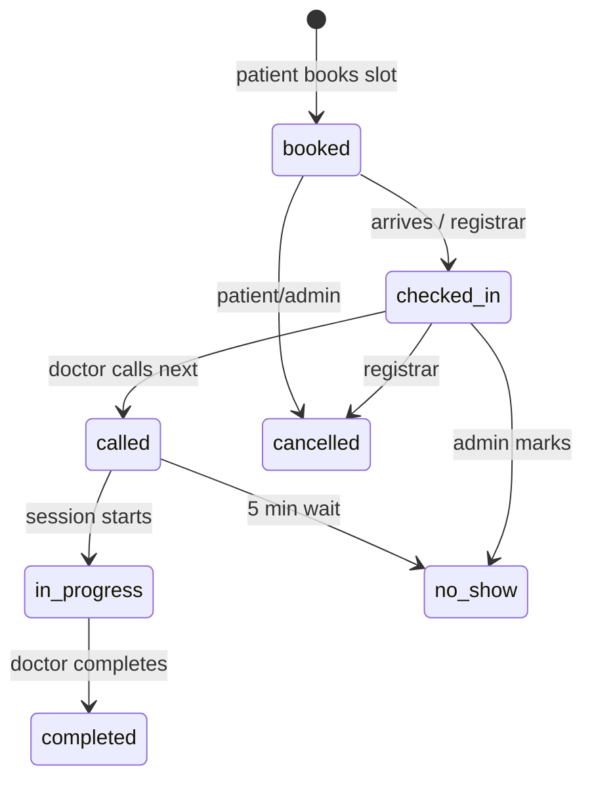

# CuraMed — District Polyclinic Queue Management Platform

> **Status**: MVP demo — mock service layer, no real backend.
> **Purpose**: Appointment booking and queue control for Uzbekistan district polyclinics.

---

## Architecture

```
src/
├── components/         # Shared UI kit (Button, Card, Badge, Input, States, AppShell, RoleGuard)
├── features/
│   ├── auth/           # LoginPage, UnauthorizedPage
│   ├── patient/        # Home, SpecialtyPicker, DoctorList, Booking, MyTickets, QrTicket, Review
│   ├── doctor/         # DoctorDashboard (queue + call next + priority insert + auto-complete)
│   ├── registrar/      # RegistrarDashboard (walk-in booking, kiosk flow)
│   ├── admin/          # AdminDashboard, AuditLogPage, SlotConfigPage
│   └── notifications/  # NotificationsPage
├── services/
│   ├── interfaces.ts   # TypeScript interfaces — the ONLY thing UI imports from services/
│   ├── index.ts        # Barrel — re-exports concrete mock implementations
│   └── mock/
│       ├── mockData.ts
│       ├── timeService.ts      # Single source of "now"
│       ├── authService.ts
│       ├── doctorService.ts
│       ├── appointmentService.ts
│       ├── auditService.ts
│       ├── notificationService.ts
│       ├── adminService.ts
│       └── reviewService.ts
├── store/              # Zustand slices
├── router/             # React Router v6 + RoleGuard
├── i18n/               # uz (default) / ru / en
├── utils/              # Ticket state machine (FSM)
└── types/              # All domain types
```

---

## Ticket State Machine



Invalid transitions throw `InvalidTransitionError`. See [`ticketStateMachine.ts`](src/utils/ticketStateMachine.ts).

---

## Quick Start

```bash
npm install
npm run dev       # http://localhost:5173
npm test          # Vitest unit tests
npm run build
```

### Demo Logins
| Role | Phone | Code |
|------|-------|------|
| Patient | +998901234567 | 123456 |
| Doctor | +998901111111 | 123456 |
| Registrar | +998904444444 | 123456 |
| Admin | +998905555555 | 123456 |

---

## How to Replace Mocks with a Real API

1. Implement each interface from [`src/services/interfaces.ts`](src/services/interfaces.ts)
2. Swap the imports in [`src/services/index.ts`](src/services/index.ts):
   ```ts
   // Before:  export { authService } from './mock/authService';
   // After:   export { authService } from './real/authService';
   ```
3. No UI changes needed — components only import from `@/services`.

### API Endpoint Mapping
| Interface | Suggested endpoints |
|---|---|
| `IAuthService` | `POST /auth/otp/request`, `POST /auth/otp/verify` |
| `IDoctorService` | `GET /doctors`, `GET /doctors/:id` |
| `IAppointmentService` | `GET /slots`, `POST /tickets`, `PATCH /tickets/:id/transition` |
| `IReviewService` | `POST /reviews`, `GET /doctors/:id/rating` |
| `INotificationService` | WebSocket/SSE + `GET /notifications` |
| `IAuditService` | `GET /audit`, `POST /audit` |
| `IAdminService` | `GET/PUT /admin/kpi`, `/admin/specialty-config`, `/admin/flags` |

---

## Feature Flags
```ts
{ publicRatings: false }  // pilot mode — ratings visible to Admin only
```
Ratings require minimum 10 reviews. Toggle in Admin → Feature Flags.

---

## Extension Points (Out of Scope MVP)
- Pharmacy recommendations — pending legal review
- Lab vouchers/banners — pending data law clarity
- Patient data sharing — zero brokering policy
